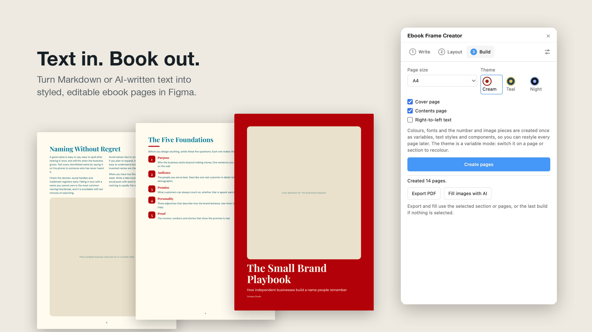
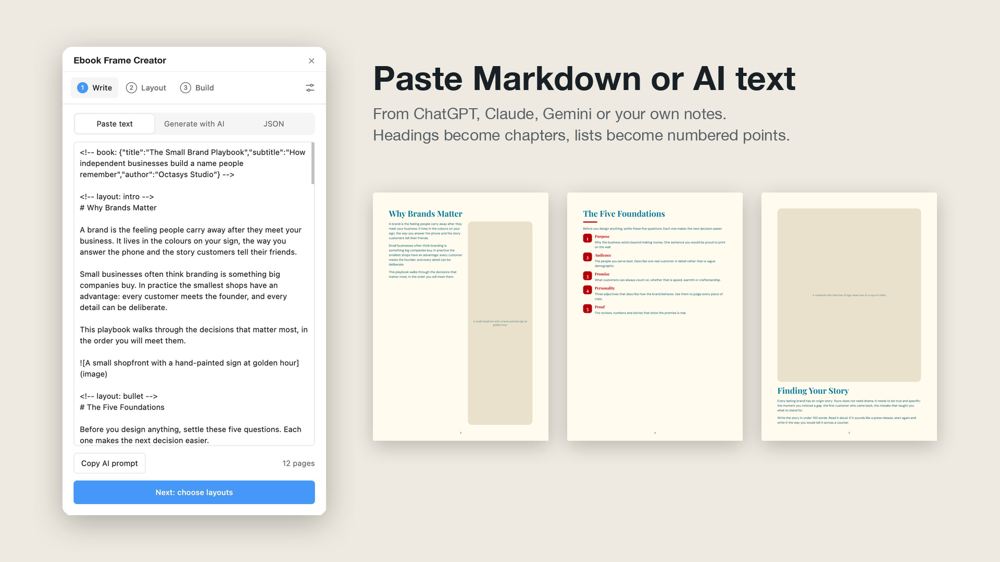
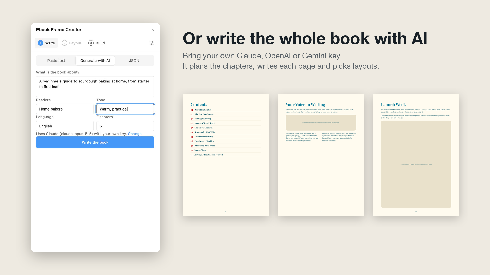
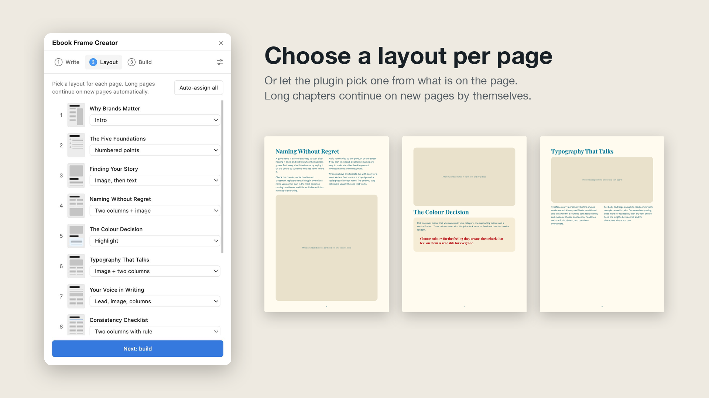
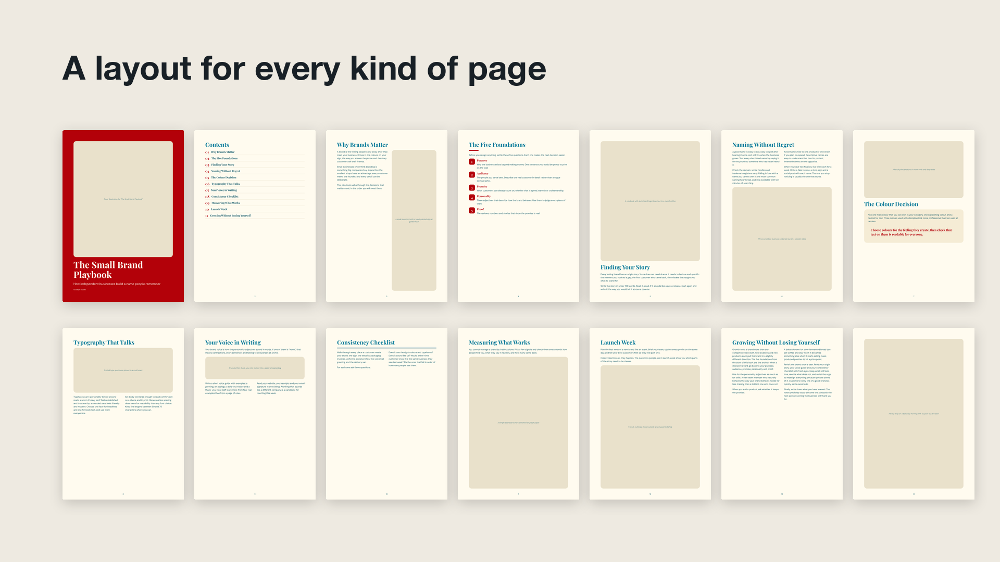
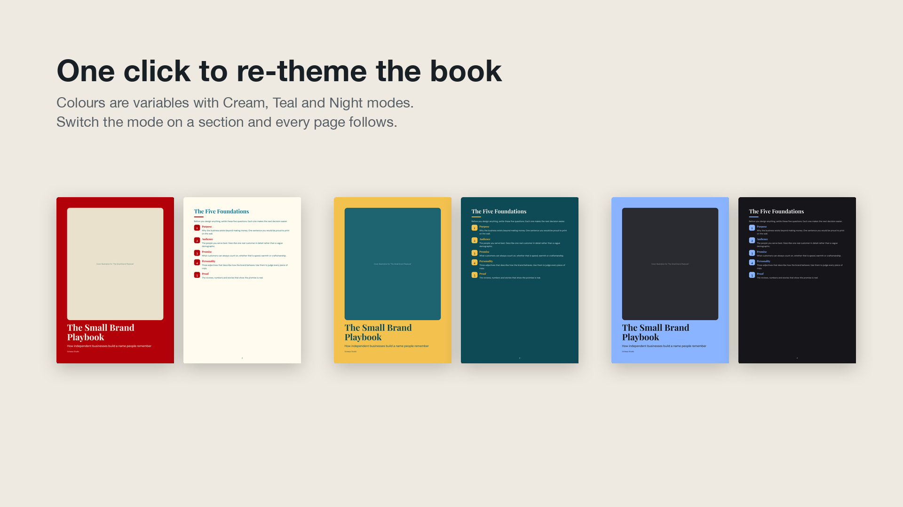
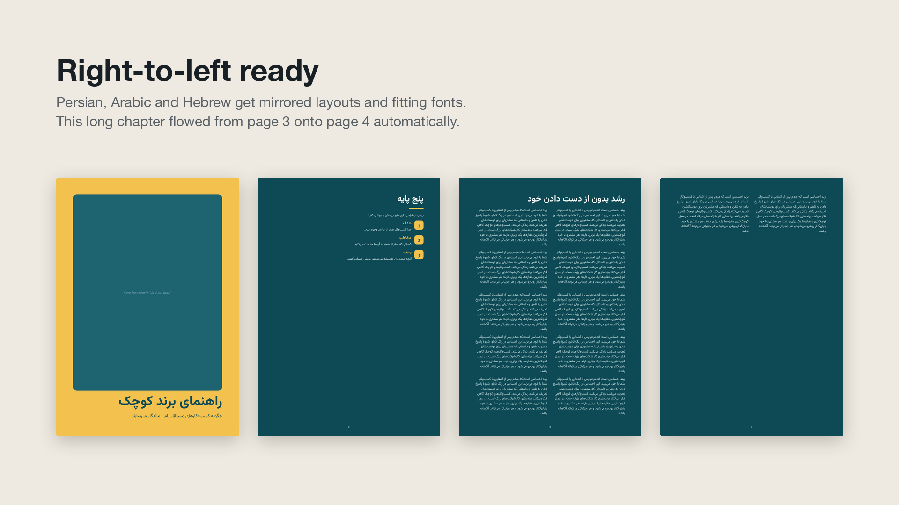
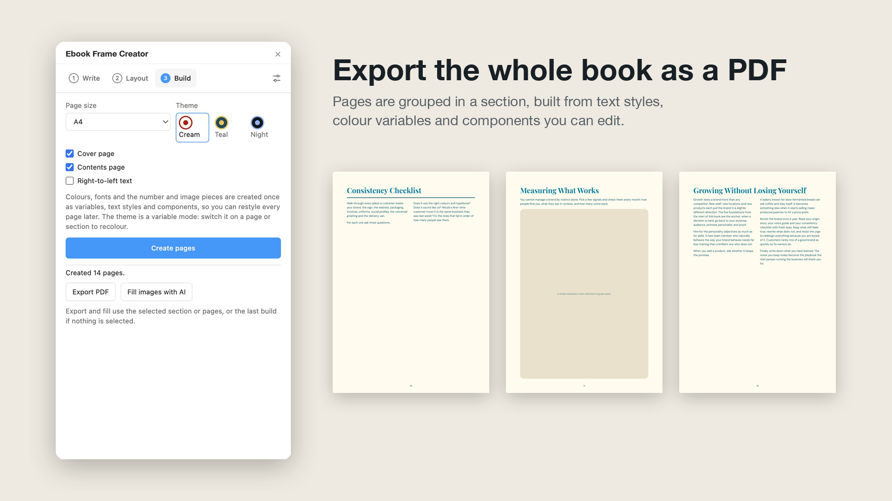

# Ebook Frame Creator

Turn Markdown or AI-written text into styled, editable ebook pages in Figma, then export the book as one PDF.

[Install from Figma Community](https://www.figma.com/community/plugin/1337309325864917425) · [Download 1.0.0](https://github.com/truthofmatthew/Figma-Plugin-Ebook-Creator/releases/tag/v1.0.0)



## What it does

1. **Write.** Paste Markdown (from ChatGPT, Claude, Gemini or your own notes), generate a whole book with your own AI key, or paste book JSON.
2. **Layout.** Each page gets one of 15 layouts. The plugin picks one from what is on the page; you can change any of them.
3. **Build.** Choose a page size and theme. Pages are created with auto layout inside a section, and long text continues onto new pages by itself. Then export a PDF or fill the image placeholders with AI.

Everything it creates is editable:

- **Colours** are variables in an `Ebook theme` collection with Cream, Teal and Night modes. Switch the mode on a page or section to recolour it.
- **Type** uses text styles (`Ebook A4/Title`, `Ebook A4/Body`, …). Change a style and every page follows.
- **Number badges and image placeholders** are components on an `Ebook components` page.

It also works in **Figma Slides** (one slide per page) and with **right-to-left** text (Persian, Arabic, Hebrew), which gets mirrored layouts and a fitting font.

## Screenshots

Every page below was made by the plugin from [`examples/small-brand-playbook.md`](examples/small-brand-playbook.md).

| | |
|---|---|
|  |  |
|  |  |
|  |  |
|  | |

## Writing the text

Plain Markdown works:

```markdown
# Chapter title

A paragraph. **Bold** and *italic* are kept.

1. **First point**
   A sentence or two explaining it.
2. **Second point**

> A quote or tip, shown in a card.


```

- `#` starts a new page. The first heading on a page becomes its title, and pages that open with a `#` or `##` heading are listed on the contents page.
- `---` forces a page break.
- Put `<!-- layout: two-column-1 -->` on its own line to start a page with a specific layout.
- `<!-- book: {"title": "…", "subtitle": "…", "author": "…"} -->` sets the cover text.
- Version 0.x markers such as `#>page-bullet<#` still work.

**Copy AI prompt** in the plugin copies a prompt that asks any chatbot for text in this format.

### Layouts

| id | Layout |
|----|--------|
| `cover` | Book title, subtitle and author on a full-colour page |
| `toc` | Numbered list of chapter titles (made for you from the page titles) |
| `intro` | Title, text on one side, tall image on the other |
| `simpletext` | Title and flowing text |
| `bullet` | Numbered points with short explanations |
| `image-desc` | Large image on top, text below |
| `image` | Text on top, large image below |
| `overview` | Title, a short lead and an image |
| `highlight` | Image on top, text in a coloured card |
| `two-column-1` | Two text columns, image below |
| `two-column-2` | Image band, then two text columns |
| `two-column-3` | Lead paragraph, image strip, two columns |
| `two-column-4` | Title, divider line, two columns |
| `two-column-5` | Long text in two columns |
| `placeholder` | One image filling the page |

### Book JSON (for scripts, agents and batch runs)

The JSON tab takes one book or a list of books; a list builds one section per book. This is also the format to hand to an AI agent working through the Figma MCP server.

```json
{
  "title": "The Small Brand Playbook",
  "subtitle": "How independent businesses build a name people remember",
  "author": "Octasys Studio",
  "direction": "ltr",
  "pages": [
    {
      "layout": "bullet",
      "blocks": [
        { "type": "heading", "level": 1, "text": "The Five Foundations" },
        { "type": "paragraph", "text": "Settle these before you design anything." },
        { "type": "numbered", "items": [{ "title": "Purpose", "body": "Why the business exists." }] },
        { "type": "image", "text": "A notebook with logo sketches" }
      ]
    }
  ]
}
```

Block types: `heading` (`text`, `level` 1–3), `paragraph`, `quote`, `image` (`text` is the image description), `bullets` and `numbered` (`items` with `title` and optional `body`). The full schema is in [`src/spec.ts`](src/spec.ts).

## AI features (optional)

Pasting text needs no key. To generate books or images, open **Settings** and add a key:

- **Writing:** Claude (default model `claude-opus-5-5`), OpenAI or Gemini. The plugin plans the chapters, then writes each chapter with structured output, so the answer always fits the book format.
- **Images:** an OpenAI key and image model (`gpt-image-1` by default). **Fill images with AI** replaces each placeholder in the selection, or in the last build, with a generated picture of its caption.

Keys are stored on your computer in Figma's plugin storage and sent only to the provider you use. The plugin can only reach `api.anthropic.com`, `api.openai.com` and `generativelanguage.googleapis.com`.

## Development

```bash
npm install
npm run build       # dist/main.js and dist/ui.html
npm run watch       # rebuild on change
npm test            # parser and page-flow tests
npm run typecheck
```

In Figma: **Plugins → Development → Import plugin from manifest…** and pick `manifest.json`.

```
src/
  spec.ts          BookSpec types, validation, JSON schemas for AI output
  markdown.ts      Markdown -> BookSpec, BookSpec -> Markdown, auto layout choice, cover/contents
  layout.ts        splitting paragraphs and lists across pages
  text.ts          inline bold/italic, sentences, RTL detection
  messages.ts      UI <-> plugin messages, page sizes, settings
  main/            plugin sandbox: theme (variables, styles, components) and page rendering
  ui/              Preact UI, AI calls, PDF export, layout previews
test/              Vitest tests
examples/          the example book used by "Load example"
scripts/           dev helpers to run the renderer inside a Figma file through the Figma MCP server
```

## Version history

### 1.0.0 — October 2026
- Rebuilt in TypeScript with esbuild and a Preact UI that follows Figma's light and dark theme.
- Standard Markdown input with optional layout comments; the 0.x markers still work.
- Pages use auto layout, text styles, colour variables (three theme modes) and components.
- Long content continues onto new pages; two-column layouts balance their columns.
- Cover and contents pages, four page sizes, Figma Slides support, right-to-left layouts.
- Book generation with Claude, OpenAI or Gemini; image fill with OpenAI; one-click PDF export.
- Book JSON input, including batches of several books.

### 0.2.0 — October 2026
- Falls back to Inter when Roxborough CF or DM Sans is missing (most installs failed before).
- Fixed crashes in the two-column layouts, with unknown page markers and with text before the first marker.

### 0.1.x — February–March 2024
- First versions: 14 templates driven by `#>page-…<#` markers and a ChatGPT prompt.

## License

ISC. Made by Mathew (MT) Karimi.
